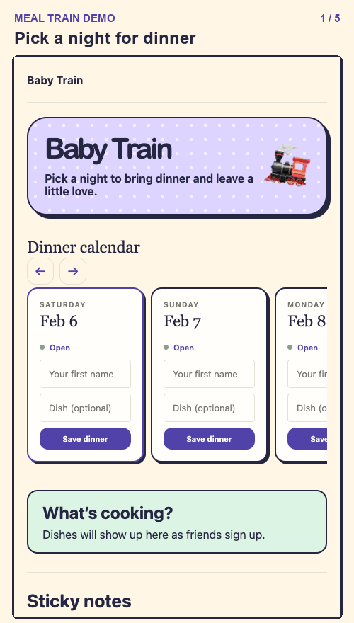

# Meal Train Starter

A small meal train app with a swipeable dinner calendar, a list of who's bringing each dish, and a shared sticky-note board. The walkthrough uses fictional guests and meals.



## Run locally

Install Node.js and [uv](https://docs.astral.sh/uv/getting-started/installation/). From the project folder:

```sh
npm ci
uv sync --locked --python 3.12
(
  umask 077
  test ! -e .dev.vars || exit 1
  printf 'INVITE_KEY=%s\nOWNER_KEY=%s\nGUEST_PASSWORD=%s\n' \
    "$(openssl rand -hex 32)" "$(openssl rand -hex 32)" "$(openssl rand -hex 16)" > .dev.vars
)
npx wrangler d1 migrations apply DB --local
uv run --python 3.12 pywrangler dev
```

Open [the local app](http://localhost:8787/babytrain/) and sign in with the `GUEST_PASSWORD` in `.dev.vars`. The calendar defaults to 21 days starting today. Set `START_DATE`, `TRAIN_DAYS`, and `TRAIN_TIME_ZONE` in `wrangler.jsonc` to customize it.

## Host your own copy

Create a Cloudflare D1 database and put its name and ID in `wrangler.jsonc`. Choose your own Worker name and hostname or set `workers_dev` to `true` for a workers.dev address. Run `npx wrangler d1 migrations apply DB --remote`, then deploy with `uv run pywrangler deploy --secrets-file .dev.vars`. Use fresh keys and a strong password for your hosted copy. The guest password grants access to the calendar and notes. The separate invite key also supports links in the form `/babytrain/#invite=YOUR_INVITE_KEY`.
